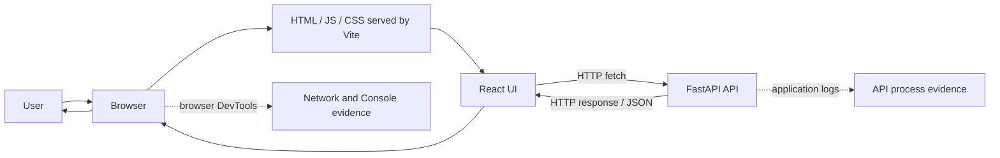

# Week 1 — GroundOps
## The Human Infrastructure Layer of AI-Native Engineering

**Content status:** Draft for review; not approved.  
**Instructor-led teaching allocation:** 150 minutes (2.5 hours), excluding labs.  
**Separate hands-on lab allocation:** 180 minutes (two 90-minute labs).  
**Primary workload:** React single-page frontend + Python FastAPI API.  
**Audience:** Learners comfortable with basic programming and command-line use, but not assumed to have production DevOps experience.

## Why this is the first module

The first question is not “Which `kubectl` command should I memorize?” It is: **What evidence would convince me that a system is delivering the outcome a user needs, and what would I do when that evidence disagrees with what a tool reports?**

AI coding tools can generate code, configuration and commands. Those are proposals and artifacts. They do not independently establish that the right version was deployed, that permissions are safe, that a browser can reach an API, that data was preserved, or that the user-visible outcome is correct. GroundOps is this course's name for the human operational capability that closes that gap. “GroundOps” is a curriculum term used here, not a claim that the industry has one universally standardized definition for it.

## Learning outcomes

At the end of the week, a learner should be able to:

1. Explain the difference between generated artifact, desired state, observed runtime state, and verified user outcome.
2. Trace one request through the React frontend and FastAPI backend using browser DevTools, `curl`, and API process logs.
3. Identify the first failing boundary in a small full-stack request path instead of randomly restarting components.
4. Explain why process-running, endpoint-response, browser-accepted response, and successful user workflow are different claims.
5. Use an evidence-first diagnostic loop and distinguish observation, hypothesis, test, root cause and fix.
6. Review an AI-generated operational change for context, permissions, versioning, observability, rollback and proof of success.
7. Record uncertainty and test status honestly: not run, source-reviewed, locally executed, or verified against a real cloud environment.

## Delivery plan

| Lesson | Title | Teaching minutes | Format |
|---|---|---:|---|
| GRO-L01 | The Human Infrastructure Layer | 45 | Problem narrative, responsibility boundaries, worked case, instructor-led discussion |
| GRO-L02 | Trace the Full-Stack Request | 55 | Architecture walkthrough, request tracing, boundary map, browser/API evidence |
| GRO-L03 | Evidence-First Operations | 50 | State/evidence model, hypothesis testing, safe-change contract, exit assessment |
| **Total** |  | **150** | Labs are scheduled separately. |

## Required lesson order

1. Read `lessons/GRO-L01-human-infrastructure-layer.md`.
2. Read `lessons/GRO-L02-trace-the-full-stack-request.md`.
3. Read `lessons/GRO-L03-evidence-first-operations.md`.
4. Execute `labs/GRO-LAB01-run-and-trace-the-request.md`.
5. Execute `labs/GRO-LAB02-diagnose-the-broken-request-path.md` only after the baseline request has been recorded.

## Architecture under investigation

This is the **local development topology** for Week 1. It is intentionally not a production deployment diagram. It omits TLS termination, reverse proxies, ingress/load balancers, identity providers, secrets managers, databases, message queues, background workers, CI/CD, container boundaries and cloud infrastructure. Those are deferred until later modules. The reliable conclusion that still holds is that the browser and API are separate components communicating over HTTP, with a boundary at which availability, addressing, response semantics and browser origin policy can fail.

## Artifacts delivered in this batch

- The three instructor-ready lesson drafts above.
- Two separate, detailed labs with deliberately injected failures.
- `starter-app/` — source files used by the labs.
- `environment-matrix.md` — initial researched baseline and open compatibility decisions.
- `course-map.md` — 18-week lesson/lab IDs and teaching/lab allocations.
- `quality-ledger.md` — actual status, blockers and review evidence.

## Evidence and publication warning

The source claims in this module link to official React, Vite and FastAPI documentation, MDN's HTTP/CORS guides, and the Google SRE book. Sources support the claims linked to them; their presence is not a blanket endorsement of every teaching recommendation.

The generated starter files have not been built with the exact pinned Python/Node/package versions. The exact `uv.lock` and `package-lock.json` files are not included in this draft. As a result, this module is **not approved for release** until the maintainer produces and commits those lockfiles, executes the labs on the stated baseline, records results, and closes the quality-ledger blockers.
