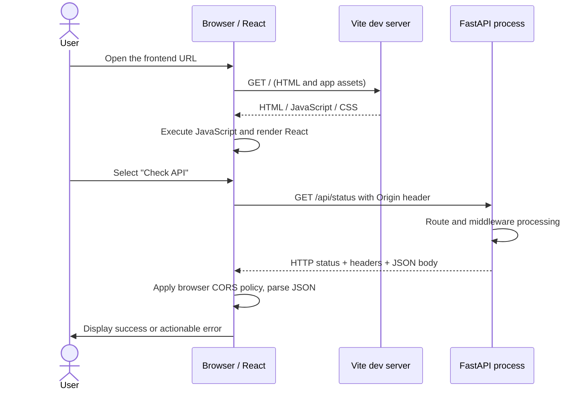

# GRO-L02 — Trace the Full-Stack Request

**Teaching time:** 55 minutes  
**Central mystery:** The React page renders, but its data card fails. Where did the request stop, and what evidence identifies that boundary?

**Prerequisites:** GRO-L01's distinction between a running part and a verified outcome. No programming or terminal experience is assumed.

## Before the explanation: predict

You can see **Check API** on the page. Predict what happens if the API program stops but the program serving page files stays running. Could the button remain visible while its action fails? Give a reason before reading the trace.

The inherited capability is naming an evidence boundary. Now we need to locate it: the browser can obtain page files from one program and request data from another. A visible button does not establish that second exchange; equally, a failed API call does not prove the page-file server failed.

**Reading route:** the 55-minute core is the prediction, six-step request, CORS worked comparison, instruments and transfer. Production-scale notes are extension/reference reading. The allocation remains unvalidated with novices; lab setup and execution have their own timebox.

## Mapped model and its limits

Think of a shop directory and a separate service counter. Seeing the directory does not prove a clerk is present at the counter.

| Familiar entity/action | Technical mapping |
|---|---|
| Directory telling you what is available | Vite delivers HTML (page structure), CSS (appearance) and JavaScript (behavior) |
| Person following the counter address | Browser code starts a separate HTTP request to the API URL |
| Numbered counter and named task | Port identifies a listening endpoint; method and path identify the requested operation |
| Clerk's reply and the customer's display | API returns status/headers/body; browser code interprets them and updates React's screen |

**Limit:** a counter number is not permission. CORS has no faithful physical-shop counterpart: it is a browser rule governing whether page code may read a cross-origin response, not whether a customer is authenticated. Return to the actual request headers for that decision.

## 1. Architecture first: a user-visible action crosses boundaries

The Week 1 application is a React single-page application served locally by Vite and a separate FastAPI process. They are two programs, listening on two ports. The browser coordinates the user interface and initiates the HTTP request. FastAPI receives the API request and returns an HTTP response. React interprets the response and updates the page.



The browser's initial request for the HTML and JavaScript is a separate request from the later API `fetch`. A React screen can load successfully while the API is down because the files that render the screen came from the frontend server. Conversely, the API's `/docs` page can work while the frontend fails to contact it because the browser-to-API path has additional requirements. HTTP is a client/server request-response protocol; MDN gives an accessible description of the participants and the request and response messages in its [HTTP overview](https://developer.mozilla.org/en-US/docs/Web/HTTP/Guides/Overview).

## 2. Walk from the user's click to the returned JSON

### Step 1 — The browser loads the frontend

The learner navigates to `http://127.0.0.1:5173`. Vite serves the development version of the application. The browser receives an HTML document that references JavaScript and CSS. It executes the JavaScript; React builds the user interface inside the page root.

**What this proves:** the frontend server served enough assets for the browser to render the page.  
**What it does not prove:** that the API server is running, that the API URL is correct, or that a later API request will succeed.

### Step 2 — React initiates an HTTP request

When the user selects **Check API**, the React handler uses `fetch()` to request `http://127.0.0.1:8000/api/status`. In this training environment, the request target is explicit so learners can trace it. Later modules will replace baked-in development assumptions with a deliberate build/deployment configuration strategy.

The URL can be decomposed into:

- Scheme: `http`
- Host: `127.0.0.1`
- Port: `8000`
- Path: `/api/status`

Each element is a possible fault boundary. A scheme mismatch can create mixed-content or TLS-related failures in a secure deployment. A wrong host may point at a different machine or name. A wrong port may point at no listener. A wrong path may reach the correct server but return `404`.

### Step 3 — The request reaches the API boundary

The browser sends an HTTP request. Uvicorn is the program owning the network listener; ASGI is the interface by which it passes requests to FastAPI. FastAPI's middleware handles cross-cutting rules such as CORS, and its router maps a method (`GET`, asking to retrieve) plus path to a Python function. No Python authoring is required here. The function returns JSON: named fields with values that page code can read. The supplied `main.py` returns these exact values:

```json
{
  "service": "groundops-api",
  "status": "available",
  "message": "The browser reached the FastAPI endpoint.",
  "version": "0.1.0"
}
```

FastAPI's introductory documentation shows how a path operation maps an HTTP method and path to a Python function, and how Python values are returned as JSON; see [FastAPI First Steps](https://fastapi.tiangolo.com/tutorial/first-steps/). We use that behavior here but do not yet make claims about production capacity, authentication or availability guarantees.

`service` names the app, `status` is its declared status text, `message` is display text, and `version` is an application label—not a unique source revision. The fixed message says “browser” even when curl asks for it. It is not proof of the caller's identity or a captured browser execution.

**What a direct API test proves:** if `curl http://127.0.0.1:8000/api/status` returns the expected response, the caller running `curl` reached a server that handled this route at that moment.  
**What it does not prove:** the browser uses the same target, can reach the same network path, will accept the cross-origin response, or will interpret the response correctly.

### Step 4 — HTTP status, response body and browser policy are separate

A response has status, headers and (often) a body. HTTP status communicates the result of the request at the HTTP layer. A `200 OK` is not proof of semantic correctness; a `404` may prove that a reachable server does not have the requested route; a `500` means the server reported an internal failure for that request. Use the actual status and body as evidence rather than assuming all non-success cases are equivalent. See [MDN — HTTP messages](https://developer.mozilla.org/en-US/docs/Web/HTTP/Guides/Messages).

The JavaScript `fetch()` promise (a placeholder for an asynchronous result) normally **resolves** when an HTTP response arrives even if the response status is `404` or `500`. Application code must check `response.ok` (true for status 200–299) or `response.status`; otherwise, it can try to parse an error response as if it were success. Network-level failures and browser CORS enforcement may instead cause the JavaScript request to reject. See [MDN Window.fetch](https://developer.mozilla.org/en-US/docs/Web/API/Window/fetch). This distinction matters when writing reliable UI states.

### Step 5 — The browser applies CORS where relevant

The frontend origin is `http://127.0.0.1:5173` and the API origin is `http://127.0.0.1:8000`. An origin is composed of scheme, host and port, so these two URLs are not same-origin because their ports differ. `http://localhost:5173` is also a different origin from `http://127.0.0.1:5173`, because the host differs.

Cross-Origin Resource Sharing (CORS) is a browser-enforced policy involving HTTP headers. The server can tell the browser which origins may read responses. Some cross-origin requests require a preflight `OPTIONS` check before the actual request; not every simple `GET` requires preflight. Importantly, **CORS is not API authentication or authorization**. A request may reach the server while browser JavaScript is prevented from reading the response because the expected response headers are absent or incorrect. A direct `curl` command is not a browser and does not enforce the browser's CORS policy in the same way.

Use both the [MDN CORS guide](https://developer.mozilla.org/en-US/docs/Web/HTTP/Guides/CORS) and [FastAPI's CORS tutorial](https://fastapi.tiangolo.com/tutorial/cors/) for the exact header and framework behavior. Do not “fix” CORS by reflecting any arbitrary `Origin` or by enabling credentials without a specific authenticated use case.

### Step 6 — React renders the result, but the user outcome is still the final boundary

React may show the message from the API, render an error state, or remain stuck in a loading state. Each of those is a user-visible behavior to verify. The correct outcome for this lab is:

1. The page renders without a browser runtime error.
2. The click generates exactly the expected API request.
3. The API receives the expected route and returns the documented JSON.
4. The browser permits the response to be read.
5. The UI displays the returned status and message.
6. Failure paths display a useful error, not a false success or an infinite spinner.

This end-to-end assertion is stronger than “the frontend started” plus “the backend started.”

### Worked trace — one changed condition

**Illustrative values, not captured execution.** Assume one laptop, Vite at `http://127.0.0.1:5173`, Uvicorn at `http://127.0.0.1:8000`, the supplied route and no proxy, credentials or custom request headers.

1. Load the page; the files arrive from port 5173. Predict whether a plain cross-origin `GET /api/status` needs a preflight before continuing.
2. Click **Check API**. The browser requests port 8000 with `Origin: http://127.0.0.1:5173`. This simple GET needs no preflight. Adding a non-safelisted header would change that assumption.
3. The handler returns HTTP 200 and the JSON above. With the matching allowed origin, middleware adds `Access-Control-Allow-Origin: http://127.0.0.1:5173`.
4. The browser permits page code to read the response. The app checks status, parses JSON and displays **Response received** with the fields. That is the expected local outcome, not proof of production readiness.
5. Change only the API allowlist to `http://localhost:5173` and restart the API, keeping the browser at `127.0.0.1`. Predict the HTTP result and browser result separately.
6. The same GET can still reach the handler and return 200. For this disallowed origin, **Access-Control-Allow-Origin is absent**; FastAPI's middleware does not substitute the different allowed origin. Curl can print the body, while the browser withholds it from page code. Console supplies the policy diagnostic; the app gets a generic fetch failure.
7. Compare the effective allowlist with the actual Origin and response header. Restore the exact intended allowlist, restart the API and repeat both direct and browser checks. Do not change the page hostname as well: that could change name resolution and confound the comparison.

If a matching header appears yet the page still fails, the simple allowlist hypothesis is insufficient. Check the browser's actual response, request mode, cache/proxy differences and page handling. One test surviving contradiction is not proof that no other cause exists.

## 3. A diagnostic instrument proves only its part of the story

| Instrument | What to inspect | What it can support | What it cannot prove alone |
|---|---|---|---|
| Browser address bar | Exact scheme, host, port and path | Which frontend URL the learner opened | API reachability |
| Browser DevTools → Network | Request URL, method, status, timing, response headers/body where available | Whether the browser attempted the call and what network-level result it recorded | Full backend internal reason unless accompanied by server evidence |
| Browser DevTools → Console | JavaScript errors and browser policy messages | Client-side exceptions, visible CORS diagnostics | That every server component is healthy |
| `curl -i` against API | Status line, response headers, body | Direct reachability and HTTP response from the command's network location | Browser CORS behavior or React rendering |
| FastAPI process terminal | Request/exception logs available at the configured log level | Evidence that the process received/handled a request or emitted an exception | Requests that were never logged, or all upstream browser behavior |
| Source/config files | URL constants, origin allowlist, route declarations | Intended configuration | Effective running configuration if environment overrides or stale process state exist |

Google SRE's monitoring discussion emphasizes using external symptom signals and internal signals together, especially in a multilayered system. A front-end request's delay may be a symptom for the frontend owner and a clue about a downstream dependency for the API owner. See [Google SRE — Monitoring Distributed Systems](https://sre.google/sre-book/monitoring-distributed-systems/).

## 4. Compare three failures that can look alike

### Failure A — Wrong API target

**Symptom:** the status card says it cannot fetch.  
**Discriminating evidence:** Network tab shows a request to the wrong port/host or a connection-level failure. A direct `curl` to the known-good API URL succeeds. The FastAPI log may show no corresponding request because the browser targeted another location.  
**Likely fix:** correct the configured API URL, restart/rebuild the relevant frontend process if configuration is read at startup/build time, then repeat both direct and browser tests.  
**Do not assume:** “no API log” alone proves the API never received traffic; first confirm log completeness and the actual target.

### Failure B — API process stopped

**Symptom:** same client message.  
**Discriminating evidence:** a direct `curl` to the expected URL fails with connection refused or timeout, and the API process terminal indicates the process has stopped or never started.  
**Likely fix:** understand why the process stopped, restart it in a controlled way, and repeat health plus route plus browser checks. Do not treat restart as root-cause analysis: if it exits again, inspect logs and the exit condition.

### Failure C — CORS origin mismatch

**Symptom:** the browser reports a CORS policy error or JavaScript sees a rejected fetch, yet direct `curl` may work.  
**Discriminating evidence:** the browser's Network/Console evidence shows a cross-origin request; the response lacks the necessary `Access-Control-Allow-Origin` for the actual browser origin or sends a different value. The API's log may show that it received the request.  
**Likely fix:** configure the smallest intended development origin allowlist, restart the API if its settings are read on startup, and retry from the exact frontend origin.  
**Do not do:** disable browser security, add a broad origin allowlist as a production shortcut, or claim CORS supplies authentication.

The three cases show why the same UI message is not a root cause. Diagnostics narrow a hypothesis by finding the first boundary whose observed behavior differs from expectation.

## 5. A repeatable trace worksheet

For one click, record:

| Field | Student entry |
|---|---|
| Frontend URL opened |  |
| Browser origin |  |
| Expected API URL |  |
| Actual API URL in Network tab |  |
| HTTP method and path |  |
| Browser result/status |  |
| Response status and `Access-Control-Allow-Origin`, if visible |  |
| Direct `curl -i` result |  |
| API log observation and logging limitations |  |
| First boundary where expectation and evidence diverge |  |
| Current hypothesis (not yet root cause) |  |
| Test that would falsify this hypothesis |  |

Do not fill “root cause” until you have tested your explanation against credible alternatives and checked a targeted correction. Filling a worksheet is not verification. Record unknowns rather than guessing values.

## 6. Why `localhost` is context-dependent

`localhost` is a host name that refers to the loopback interface of the machine or network namespace where name resolution and the connection occur. The browser, a container, a remote VM and a Kubernetes Pod can have different loopback interfaces. Always identify which process interprets the name and where that process runs; do not assume every use of `localhost` refers to one universal host.

The principle to carry forward is **network names are relative to the caller's execution context**. Verify from the location that actually initiates the connection.

## Production pain pattern

The laptop's direct path removes intermediaries, not the need to identify the caller. In production a DNS service resolves names, an edge/cache may reuse a response, and a load balancer selects an API instance. Any intermediary may answer before the API receives the request.

| Failure mechanism | Discriminating evidence / control | Limit or cost |
|---|---|---|
| A cache reuses one origin's permission header for another | Compare actual Origin/response; send `Vary: Origin` when responses vary by origin | Preflight caching is separate; its maximum age trades repeated checks against stale permissions |
| A failed response hides a completed operation, then a retry duplicates it | Use a server-supported request identifier/deduplication contract for non-idempotent work; bound retries with delay/jitter | Idempotent means repeated intended effect is unchanged, not that unlimited retries are safe or free |
| An outer timeout expires while a dependency keeps working | Compare deadlines and request-linked logs; bound client waiting and downstream work | Timeout is not proof the server did nothing; cancellation may not undo side effects |
| One old instance or region fails behind a healthy average | Split results by instance/version/region and identify the layer producing the response | More evidence costs storage; choose labels deliberately rather than putting every user ID in metrics |
| Logs cannot join the steps of one request | A trace ID joins recorded spans (one operation's timed segments) across services | Missing instrumentation or sampling leaves gaps; an ID does not guarantee a complete causal story |

For an illustrative fan-out of **100 independent calls**, each with a **1%** chance of crossing a chosen slow threshold, the chance of at least one slow call is `1 − 0.99^100 ≈ 63%`. Independence and equal probabilities are assumptions, not measurements. This shows why an acceptable average can hide a slow user action, not what the lab's latency is.

The HTML extension discusses loopback in ordinary isolated container/Pod networking. Those are caller-context examples, not instructions to expose this local server on every interface. Host networking, port forwarding and IPv4/IPv6 resolution can change reachability; do not generalize a container example to every topology.

### Extension details and limits

For HTTP(S) pages, origin is a **parsed, normalized scheme/host/effective-port tuple**, not the whole typed URL. Localhost and 127.0.0.1 are distinct hosts even when they reach the same machine; they need not resolve to the same address family. A proxy, published port or authorized SSH forward can deliberately connect otherwise separate network contexts.

Preflight permission can be cached, so not every non-simple call incurs another OPTIONS round trip. MDN documents browser-specific maximum-age caps, and FastAPI's middleware defaults to 600 seconds. A cached preflight permission does not remove checks on the actual response. Vary: Origin concerns a separate HTTP cache when response headers depend on Origin.

Timeouts bound waiting, not necessarily server effects. `AbortSignal.timeout(5000)` uses 5000 milliseconds of **active** time and can pause while a document is suspended. Idempotency means the intended effect of repetition is unchanged, not that responses must be identical or retries cost nothing. Non-idempotent operations need a deliberate safe-replay contract; bound retries and account for load.

HTTP 502, 503 and 504 have different meanings; none universally means “no healthy backend.” An intermediary's health/fail-open behavior is product-specific: an AWS Application Load Balancer can route to unhealthy targets when all targets fail health checks. Keep representative user-path checks distinct from instance health decisions; a shared dependency failure must not accidentally remove all serving capacity.

W3C traceparent version 00 carries `version-trace-id-parent-id-trace-flags`. The trace ID is 16 bytes; parent-id is an 8-byte ID for the caller's operation. Instrumentation creates spans with their own IDs and parent links; a downstream header identifies its sending operation as parent-id. Retained spans can reveal relationships and durations, but missing spans, clock differences or export loss limit the conclusion. Correlation is not causal proof. These mechanisms explain the extension examples; they are not features exercised by the Week 1 app.

## Exit check

A teammate reports: “`curl` returns HTTP 200, so the frontend is working.” Repair the statement in your own words. Name the caller curl tested, the claim its status supports, and the browser/user checks still needed.

## Transfer and lab handoff

A teammate runs curl inside a remote machine and gets 200 from `localhost:8000`. Your laptop browser cannot reach the same typed address. Predict what each caller addressed. Which observation would distinguish a wrong destination from a browser policy failure? Do not change firewall rules or allowlists to answer this.

Take the blank trace worksheet into [GRO-LAB01](../labs/GRO-LAB01-run-and-trace-the-request.md). Replace every illustrative value with actual observations. Pass the successful baseline plus one bounded uncertainty to [GRO-LAB02](../labs/GRO-LAB02-diagnose-the-broken-request-path.md); compare one fault at a time. Both direct API and browser outcomes are required after recovery.

## Sources

1. MDN, [Overview of HTTP](https://developer.mozilla.org/en-US/docs/Web/HTTP/Guides/Overview) — client/server request flow.
2. MDN, [HTTP messages](https://developer.mozilla.org/en-US/docs/Web/HTTP/Guides/Messages) — status, headers and message bodies.
3. MDN, [Cross-Origin Resource Sharing](https://developer.mozilla.org/en-US/docs/Web/HTTP/Guides/CORS) — browser policy and preflight behavior.
4. FastAPI, [First Steps](https://fastapi.tiangolo.com/tutorial/first-steps/) — path operation and JSON response behavior.
5. FastAPI, [CORS](https://fastapi.tiangolo.com/tutorial/cors/) — framework configuration and origin definition.
6. Google SRE, [Monitoring Distributed Systems](https://sre.google/sre-book/monitoring-distributed-systems/) — external and internal signals in layered systems.
7. MDN, [Window.fetch](https://developer.mozilla.org/en-US/docs/Web/API/Window/fetch) — resolved HTTP errors versus rejected requests.
8. MDN, [Access-Control-Max-Age](https://developer.mozilla.org/en-US/docs/Web/HTTP/Reference/Headers/Access-Control-Max-Age) — preflight cache scope and browser limits.
9. IETF, [RFC 9110 §9.2.2](https://www.rfc-editor.org/rfc/rfc9110.html#section-9.2.2) — idempotency and retry limits.
10. W3C, [Trace Context](https://www.w3.org/TR/trace-context/) — propagated request identity, not proof of complete instrumentation.
11. Vite, [Env Variables and Modes](https://vite.dev/guide/env-and-mode) — startup loading and inherited environment precedence over env files.
12. Uvicorn, [default configuration source](https://raw.githubusercontent.com/Kludex/uvicorn/main/uvicorn/config.py) — official repository evidence for host/port defaults; the lab supplies explicit flags.
13. Docker, [networking](https://docs.docker.com/engine/network/) and [Desktop host access](https://docs.docker.com/desktop/features/networking/networking-how-tos/); Kubernetes, [Pods](https://kubernetes.io/docs/concepts/workloads/pods/) — scoped network contexts.
14. OpenSSH, [ssh manual, -L](https://man.openbsd.org/ssh) — forwarded destination connection from the remote side.
15. MDN, [AbortSignal.timeout](https://developer.mozilla.org/en-US/docs/Web/API/AbortSignal/timeout_static) and [mixed content](https://developer.mozilla.org/en-US/docs/Web/Security/Defenses/Mixed_content) — active-time cancellation and loopback exceptions.
16. AWS Builders' Library, [Timeouts, retries, and backoff with jitter](https://aws.amazon.com/builders-library/timeouts-retries-and-backoff-with-jitter/) — side effects after timeout and bounded retries.
17. AWS, [Application Load Balancer health checks](https://docs.aws.amazon.com/elasticloadbalancing/latest/application/target-group-health-checks.html) — product-specific fail-open behavior.
18. Prometheus, [Instrumentation](https://prometheus.io/docs/practices/instrumentation/) — labelsets and resource costs.
