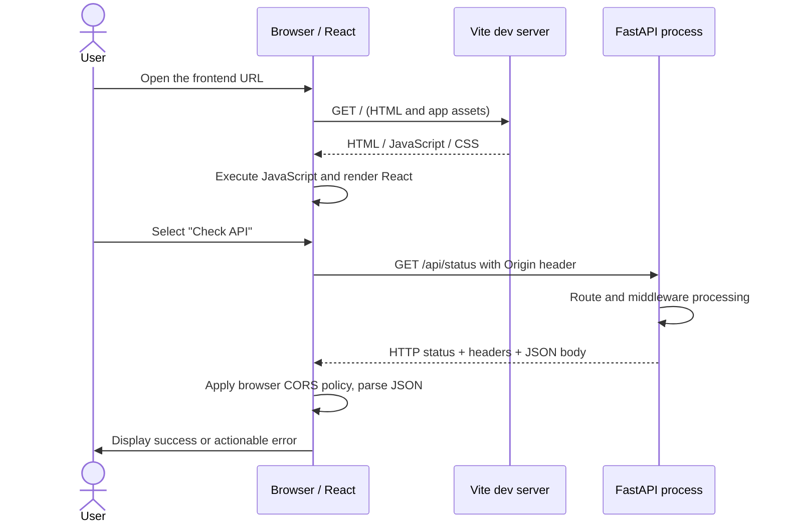

# GRO-L02 — Trace the Full-Stack Request

**Teaching time:** 55 minutes  
**Status:** Draft; source-checked, not approved.  
**Central mystery:** The React page renders, but its data card fails. Where did the request stop, and what evidence identifies that boundary?

## Instructor run sheet

| Minutes | Activity | Teaching purpose |
|---:|---|---|
| 0–5 | Revisit the user symptom | Treat it as an outcome requiring investigation. |
| 5–15 | Draw the request path from browser to API and back | Separate components and protocols. |
| 15–25 | Explain URL, host, port, origin, request/response, status and JSON | Give the vocabulary only after the need is visible. |
| 25–37 | Walk through DevTools Network, Console, `curl` and API logs | Map each tool to what it can prove. |
| 37–47 | Analyze three failure cases: wrong API URL, server unavailable, CORS mismatch | Distinguish similar symptoms through discriminating observations. |
| 47–53 | Students annotate a request trace | Demonstrate independent reasoning. |
| 53–55 | Exit check | State what each layer's success does and does not prove. |

## 1. Architecture first: a user-visible action crosses boundaries

The Week 1 application is a React single-page application served locally by Vite and a separate FastAPI process. They are two programs, listening on two ports. The browser coordinates the user interface and initiates the HTTP request. FastAPI receives the API request and returns an HTTP response. React interprets the response and updates the page.



The browser's initial request for the HTML and JavaScript is a separate request from the later API `fetch`. A React screen can load successfully while the API is down because the files that render the screen came from the frontend server. Conversely, the API's `/docs` page can work while the frontend fails to contact it because the browser-to-API path has additional requirements. HTTP is a client/server request-response protocol; MDN gives an accessible description of the participants and the request and response messages in its [HTTP overview](https://developer.mozilla.org/en-US/docs/Web/HTTP/Guides/Overview).

## 2. Walk from the user's click to the returned JSON

### Step 1 — The browser loads the frontend

The learner navigates to `http://127.0.0.1:5173`. Vite serves the development version of the application. The browser receives an HTML document that references JavaScript and CSS. It executes the JavaScript; React builds the user interface inside the page root.

**What this proves:** the frontend server served enough assets for the browser to render the page.  
**What it does not prove:** that the API server is running, that the API URL is correct, or that a later API request will succeed.

### Step 2 — React initiates an HTTP request

When the user selects **Check API**, the React handler uses `fetch()` to request `http://127.0.0.1:8000/api/status`. In this training environment, the request target is explicit so learners can trace it. Later modules will replace baked-in development assumptions with a deliberate build/deployment configuration strategy.

The URL can be decomposed into:

- Scheme: `http`
- Host: `127.0.0.1`
- Port: `8000`
- Path: `/api/status`

Each element is a possible fault boundary. A scheme mismatch can create mixed-content or TLS-related failures in a secure deployment. A wrong host may point at a different machine or name. A wrong port may point at no listener. A wrong path may reach the correct server but return `404`.

### Step 3 — The request reaches the API boundary

The browser sends an HTTP request. FastAPI's ASGI server receives it and routes it to the matching operation if the listener, network path, method and route are configured correctly. For our example, `GET /api/status` returns a small JSON document such as:

```json
{
  "service": "groundops-api",
  "status": "available",
  "message": "API request completed"
}
```

FastAPI's introductory documentation shows how a path operation maps an HTTP method and path to a Python function, and how Python values are returned as JSON; see [FastAPI First Steps](https://fastapi.tiangolo.com/tutorial/first-steps/). We use that behavior here but do not yet make claims about production capacity, authentication or availability guarantees.

**What a direct API test proves:** if `curl http://127.0.0.1:8000/api/status` returns the expected response, the caller running `curl` reached a server that handled this route at that moment.  
**What it does not prove:** the browser uses the same target, can reach the same network path, will accept the cross-origin response, or will interpret the response correctly.

### Step 4 — HTTP status, response body and browser policy are separate

A response has status, headers and (often) a body. HTTP status communicates the result of the request at the HTTP layer. A `200 OK` is not proof of semantic correctness; a `404` may prove that a reachable server does not have the requested route; a `500` means the server reported an internal failure for that request. Use the actual status and body as evidence rather than assuming all non-success cases are equivalent. See [MDN — HTTP messages](https://developer.mozilla.org/en-US/docs/Web/HTTP/Guides/Messages).

The JavaScript `fetch()` promise normally **resolves** when an HTTP response arrives even if the response status is `404` or `500`. Application code must check `response.ok` or `response.status`; otherwise, it can try to parse an error response as if it were success. Network-level failures and browser CORS enforcement may instead cause the JavaScript request to reject. This distinction matters when writing reliable UI states.

### Step 5 — The browser applies CORS where relevant

The frontend origin is `http://127.0.0.1:5173` and the API origin is `http://127.0.0.1:8000`. An origin is composed of scheme, host and port, so these two URLs are not same-origin because their ports differ. `http://localhost:5173` is also a different origin from `http://127.0.0.1:5173`, because the host differs.

Cross-Origin Resource Sharing (CORS) is a browser-enforced policy involving HTTP headers. The server can tell the browser which origins may read responses. Some cross-origin requests require a preflight `OPTIONS` check before the actual request; not every simple `GET` requires preflight. Importantly, **CORS is not API authentication or authorization**. A request may reach the server while browser JavaScript is prevented from reading the response because the expected response headers are absent or incorrect. A direct `curl` command is not a browser and does not enforce the browser's CORS policy in the same way.

Use both the [MDN CORS guide](https://developer.mozilla.org/en-US/docs/Web/HTTP/Guides/CORS) and [FastAPI's CORS tutorial](https://fastapi.tiangolo.com/tutorial/cors/) for the exact header and framework behavior. Do not “fix” CORS by reflecting any arbitrary `Origin` or by enabling credentials without a specific authenticated use case.

### Step 6 — React renders the result, but the user outcome is still the final boundary

React may show the message from the API, render an error state, or remain stuck in a loading state. Each of those is a user-visible behavior to verify. The correct outcome for this lab is:

1. The page renders without a browser runtime error.
2. The click generates exactly the expected API request.
3. The API receives the expected route and returns the documented JSON.
4. The browser permits the response to be read.
5. The UI displays the returned status and message.
6. Failure paths display a useful error, not a false success or an infinite spinner.

This end-to-end assertion is stronger than “the frontend started” plus “the backend started.”

## 3. A diagnostic instrument proves only its part of the story

| Instrument | What to inspect | What it can support | What it cannot prove alone |
|---|---|---|---|
| Browser address bar | Exact scheme, host, port and path | Which frontend URL the learner opened | API reachability |
| Browser DevTools → Network | Request URL, method, status, timing, response headers/body where available | Whether the browser attempted the call and what network-level result it recorded | Full backend internal reason unless accompanied by server evidence |
| Browser DevTools → Console | JavaScript errors and browser policy messages | Client-side exceptions, visible CORS diagnostics | That every server component is healthy |
| `curl -i` against API | Status line, response headers, body | Direct reachability and HTTP response from the command's network location | Browser CORS behavior or React rendering |
| FastAPI process terminal | Request/exception logs available at the configured log level | Evidence that the process received/handled a request or emitted an exception | Requests that were never logged, or all upstream browser behavior |
| Source/config files | URL constants, origin allowlist, route declarations | Intended configuration | Effective running configuration if environment overrides or stale process state exist |

Google SRE's monitoring discussion emphasizes using external symptom signals and internal signals together, especially in a multilayered system. A front-end request's delay may be a symptom for the frontend owner and a clue about a downstream dependency for the API owner. See [Google SRE — Monitoring Distributed Systems](https://sre.google/sre-book/monitoring-distributed-systems/).

## 4. Compare three failures that can look alike

### Failure A — Wrong API target

**Symptom:** the status card says it cannot fetch.  
**Discriminating evidence:** Network tab shows a request to the wrong port/host or a connection-level failure. A direct `curl` to the known-good API URL succeeds. The FastAPI log may show no corresponding request because the browser targeted another location.  
**Likely fix:** correct the configured API URL, restart/rebuild the relevant frontend process if configuration is read at startup/build time, then repeat both direct and browser tests.  
**Do not assume:** “no API log” alone proves the API never received traffic; first confirm log completeness and the actual target.

### Failure B — API process stopped

**Symptom:** same client message.  
**Discriminating evidence:** a direct `curl` to the expected URL fails with connection refused or timeout, and the API process terminal indicates the process has stopped or never started.  
**Likely fix:** understand why the process stopped, restart it in a controlled way, and repeat health plus route plus browser checks. Do not treat restart as root-cause analysis: if it exits again, inspect logs and the exit condition.

### Failure C — CORS origin mismatch

**Symptom:** the browser reports a CORS policy error or JavaScript sees a rejected fetch, yet direct `curl` may work.  
**Discriminating evidence:** the browser's Network/Console evidence shows a cross-origin request; the response lacks the necessary `Access-Control-Allow-Origin` for the actual browser origin or sends a different value. The API's log may show that it received the request.  
**Likely fix:** configure the smallest intended development origin allowlist, restart the API if its settings are read on startup, and retry from the exact frontend origin.  
**Do not do:** disable browser security, add a broad origin allowlist as a production shortcut, or claim CORS supplies authentication.

The three cases show why the same UI message is not a root cause. Diagnostics narrow a hypothesis by finding the first boundary whose observed behavior differs from expectation.

## 5. A repeatable trace worksheet

For one click, record:

| Field | Student entry |
|---|---|
| Frontend URL opened |  |
| Browser origin |  |
| Expected API URL |  |
| Actual API URL in Network tab |  |
| HTTP method and path |  |
| Browser result/status |  |
| Response status and `Access-Control-Allow-Origin`, if visible |  |
| Direct `curl -i` result |  |
| API log observation and logging limitations |  |
| First boundary where expectation and evidence diverge |  |
| Current hypothesis (not yet root cause) |  |
| Test that would falsify this hypothesis |  |

Students should not fill “root cause” until they have run a test that distinguishes their best explanation from credible alternatives.

## 6. Instructor discussion: why `localhost` is a trap

Ask a learner to describe `localhost` without using the phrase “the server.” The precise answer is that `localhost` is a host name referring to the loopback interface of the machine/network namespace in which name resolution and the connection occur. What that means to a browser, a container, a remote VM and a Kubernetes Pod depends on where each process runs. We will revisit this as containers and cluster networks are introduced. Do not overstate one universal `localhost` mapping across all environments.

The principle to carry forward is **network names are relative to the caller's execution context**. Verify from the location that actually initiates the connection.

## Exit check

A learner reports: “`curl` returns HTTP 200, so the frontend is working.” Ask them to repair the statement. Strong answer: “The API route returned HTTP 200 to curl from that command's environment. I still need to verify that the browser is calling the expected URL, the response is allowed by browser policy, React handles its status/body, and the requested UI outcome appears.”

## Sources

1. MDN, [Overview of HTTP](https://developer.mozilla.org/en-US/docs/Web/HTTP/Guides/Overview) — client/server request flow.
2. MDN, [HTTP messages](https://developer.mozilla.org/en-US/docs/Web/HTTP/Guides/Messages) — status, headers and message bodies.
3. MDN, [Cross-Origin Resource Sharing](https://developer.mozilla.org/en-US/docs/Web/HTTP/Guides/CORS) — browser policy and preflight behavior.
4. FastAPI, [First Steps](https://fastapi.tiangolo.com/tutorial/first-steps/) — path operation and JSON response behavior.
5. FastAPI, [CORS](https://fastapi.tiangolo.com/tutorial/cors/) — framework configuration and origin definition.
6. Google SRE, [Monitoring Distributed Systems](https://sre.google/sre-book/monitoring-distributed-systems/) — external and internal signals in layered systems.
